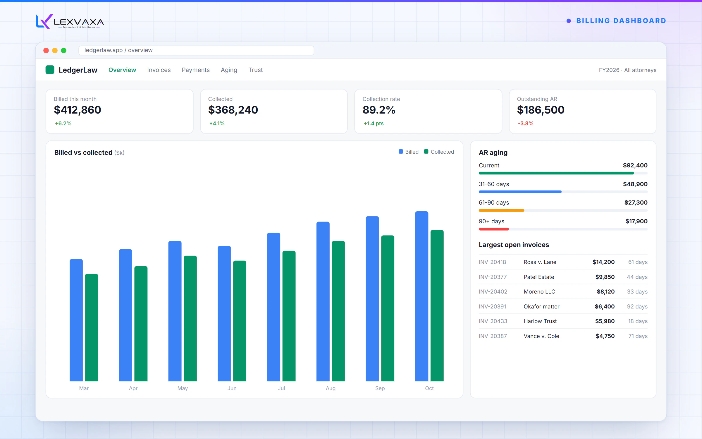

<!-- styled:v2 -->

**A finance dashboard on a law firm's billing data showing billed against collected, AR aging and the invoices that need a follow-up.**

  
  
  
  
  
  
  
  

  <a href="#overview">Overview</a> ·
  <a href="#key-features">Key features</a> ·
  <a href="#results">Results</a> ·
  <a href="#tech-stack">Tech stack</a>

---

## Overview

Billing and collection numbers had to be pulled together by hand from invoices and payments. Lexvaxa built LedgerLaw, a custom finance dashboard on the firm's billing data. It shows billed, collected and collection rate, billed against collected over time, revenue by practice area and invoice status, AR aging buckets and a list of the largest outstanding invoices. Screens shown use sample data, so no client records are exposed.

## The challenge

Partners waited for manual reports to see cash flow, and overdue invoices were easy to miss.

## The solution

n8n syncs invoices and payments from the accounting API into PostgreSQL, and a React dashboard shows collections, aging and overdue accounts live.

## Key features

- Billed, collected and collection rate
- Billed vs collected by month
- Outstanding AR and AR aging buckets
- Revenue by practice area and invoice status
- Largest open invoices with days outstanding

## Results

- Partners track cash flow and overdue accounts in one live view

## Tech stack

     

## Demo

A working version of the dashboard UI with **sample data** is in [`demo/index.html`](demo/index.html). Download it and open it in a browser; it has no build step.

## Privacy

Client names and records are confidential. Every screen in this repository uses sample data, and source code that belongs to the client is not published.

## Links

- Case study on Lexvaxa: https://lexvaxa.com/work/law-firm-billing-collections-dashboard

---

**Built by [Ch Muhammad Samiullah](https://github.com/samiullah156-creator)** · AI Automation Engineer and Full-Stack Developer at [Lexvaxa](https://lexvaxa.com)

⭐ Star this repo if you found it useful

